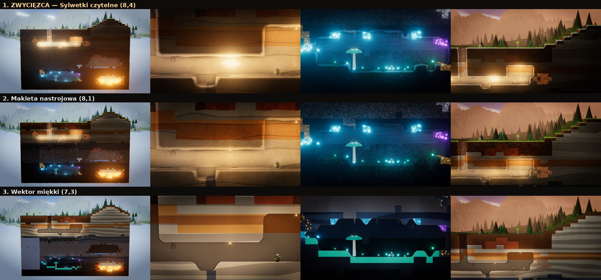
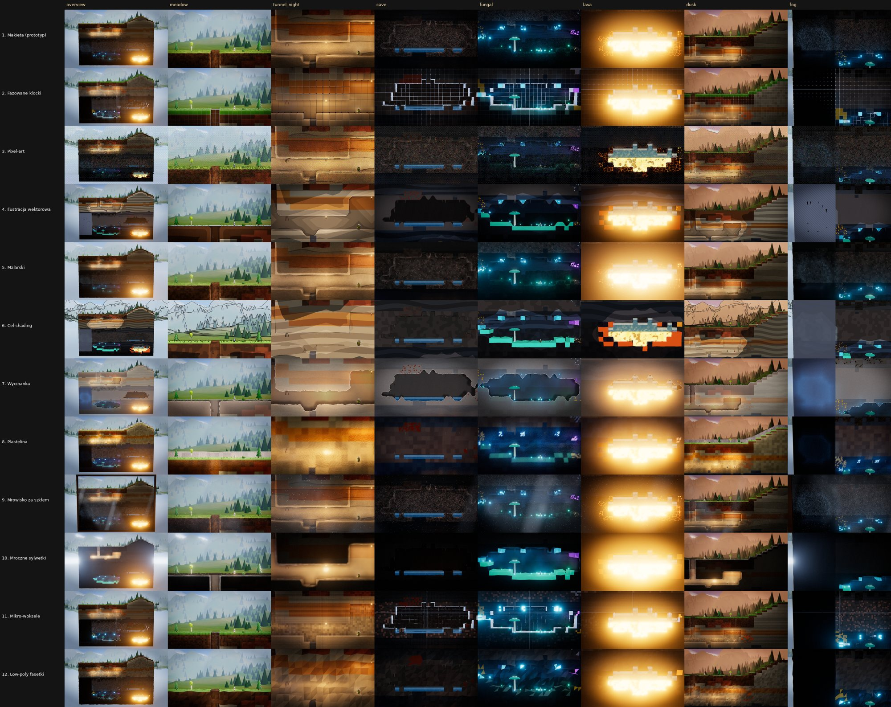
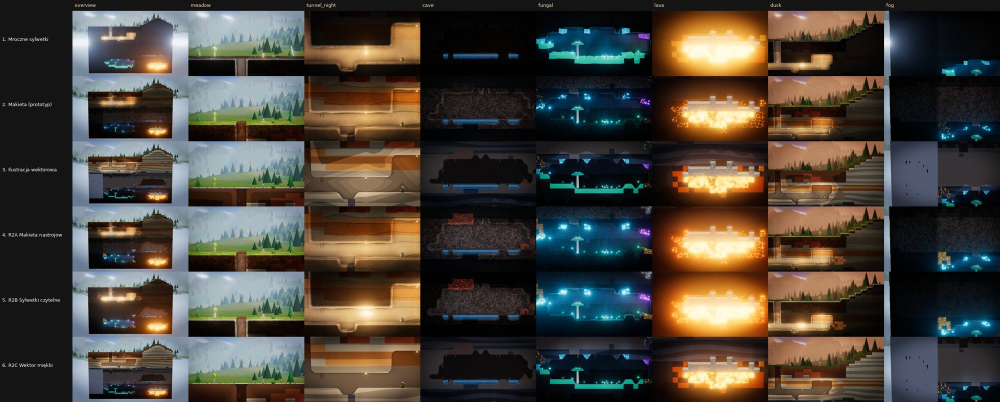

# Turniej nr 1 — styl wizualny (renderowanie świata)

**Zwycięzca: R2B „Sylwetki czytelne”** (8,4/10). Drugie miejsce: R2A „Makieta nastrojowa” (8,1) — zostaje
w grze jako ustawienie „jaśniejszy przekrój” (dostępność). Filtr malarski (S05) — kandydat na tryb zdjęć.

## Protokół
- **Arena** (`src/lab/arena.ts`): 64×46 kafli — łąka, wzgórze, szyb, tunele z pochodniami, rudy, jaskinia
  z wodą, grota grzybowa, kieszeń lawy, strefa nieodkryta, 4 manekiny krasnoludów.
- **8 scenariuszy** (`src/lab/scenarios.ts`): cały przekrój, łąka, tunel nocą, jaskinia, grota, lawa,
  zmierzch, granica nieznanego. Te same kamery i pory dnia dla każdego wariantu.
- **Automat**: `scripts/tournament.mjs` (Playwright, 960×540), plansze `scripts/contact-sheet.py`,
  metryki `scripts/metrics.py`:
  - `C_open` — kontrast luminancji skała ↔ wnętrza (czytelność przekroju),
  - `C_fog` — kontrast nieodkryte ↔ odkryte,
  - `dE_ore` — odległość barwy rudy od skały macierzystej (CIE76), `dE_deut` — to samo dla deuteranopii,
  - `dark%` — udział „zgniecionych” czerni.
- **Rubryka** (ważona): czytelność 25%, efekt „wow” 25%, atmosfera i światło 15%, spójność 10%,
  skalowalność treści (24 budowle × 3, 91 przedmiotów, 34 stworzenia generowane kodem) 10%,
  wydajność 10%, oryginalność 5%.

## Runda 1 — 12 stylów

| # | Styl | C_open | C_fog | dE_ore | dE_deut | dark% | Ocena | Uwagi |
|---|------|--------|-------|--------|---------|-------|-------|-------|
| 1 | Makieta (prototyp) | 0,375 | 0,385 | 10,2 | 9,3 | 26,6 | 7,2 | detal skał, za ciemno, rudy słabe |
| 2 | Fazowane klocki | 0,214 | 0,736 | 29,9 | 26,0 | 24,1 | 5,2 | siatka szczelin, prześwity nieba, „Minecraft” |
| 3 | Pixel-art | 0,265 | 0,188 | 11,7 | 10,2 | 21,1 | 6,0 | zbyt mocny dithering |
| 4 | Ilustracja wektorowa | 0,195 | 0,168 | 19,5 | 17,2 | 17,9 | 7,0 | czytelne kontury, kanciaste pasma światła |
| 5 | Malarski (Kuwahara) | 0,332 | 0,426 | 10,1 | 9,3 | 17,2 | 7,0 | nastrój; to filtr, nie styl |
| 6 | Cel-shading | 0,125 | 0,236 | 18,4 | 16,3 | 13,3 | 5,6 | kontury brudzą tło, plastik |
| 7 | Wycinanka | 0,115 | 0,155 | 9,3 | 8,5 | 0,4 | 6,9 | urocza, trudna dla modeli 3D |
| 8 | Plastelina | 0,238 | 0,701 | 20,4 | 18,5 | 15,1 | 4,7 | rozmyta, bez definicji |
| 9 | Mrowisko za szkłem | 0,282 | 0,398 | 8,8 | 8,1 | 15,3 | 6,7 | klimat eksponatu, pyłki = szum |
| 10 | Mroczne sylwetki | 0,501 | 0,206 | 11,8 | 10,6 | 39,7 | 7,9 | najlepszy nastrój, materiały giną w czerni |
| 11 | Mikro-woksele | 0,243 | 0,713 | 21,2 | 18,2 | 22,7 | 5,5 | prześwity, zbyt ruchliwe |
| 12 | Low-poly fasetki | 0,271 | 0,715 | 19,0 | 16,9 | 27,0 | 5,8 | szum trójkątów |

**Poprawki wspólne między rundami** (dotyczyły wszystkich stylów jednakowo): lawa świeciła tak mocno,
że bloom zamieniał ją w białą plamę (emisja obniżona ~2×); ukryte kryształy prześwitywały przez
nieodkrytą skałę jako wyraźna poświata (emisja nieodkrytych źródeł ×0,15 — zostaje tylko delikatna wskazówka).

## Runda 2 — finaliści po dopracowaniu

| Finalista | Co zmieniono | C_open | C_fog | dE_ore | dE_deut | dark% | Ocena |
|-----------|--------------|--------|-------|--------|---------|-------|-------|
| **R2B Sylwetki czytelne** | nastrój S10, ale skała zachowuje materiał; poświata krawędzi; iskrzące rudy; świecące powietrze tuneli | **0,553** | 0,458 | 28,4 | 26,2 | 26,0 | **8,4** |
| R2A Makieta nastrojowa | S01 + jaśniejsze wnętrza, iskrzące rudy, delikatna poświata powietrza | 0,457 | 0,547 | 31,9 | 29,7 | 21,9 | 8,1 |
| R2C Wektor miękki | S04 z ciągłym, miękkim światłem zamiast pasm | 0,215 | 0,186 | 18,9 | 16,5 | 18,2 | 7,3 |

Iskrzenie rud podniosło ich rozróżnialność **z ΔE 10 do 28–32** (także dla daltonistów), co jest kluczowe
w grze o kopaniu: złoże widać z daleka nawet w półmroku.

## Decyzja
- Kierunek wizualny gry: **R2B** — przekrój jak makieta, ciemna skała z widocznym materiałem i poświatą
  krawędzi, tunele wypełnione ciepłym, „żywym” światłem, iskrzące rudy, bioluminescencja w głębi.
- R2A jako ustawienie „jaśniejszy przekrój”, filtr Kuwahary jako opcja trybu zdjęć.
- Następne turnieje w tym stylu: materiały skał (paleta, wzory), światło (spadek, barwy, migotanie),
  niebo, płyny (lawa nadal zbyt jaskrawa w bloomie), dekoracje, post-processing, kamera.
