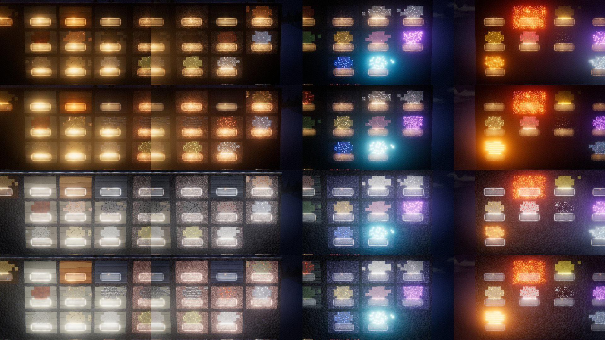
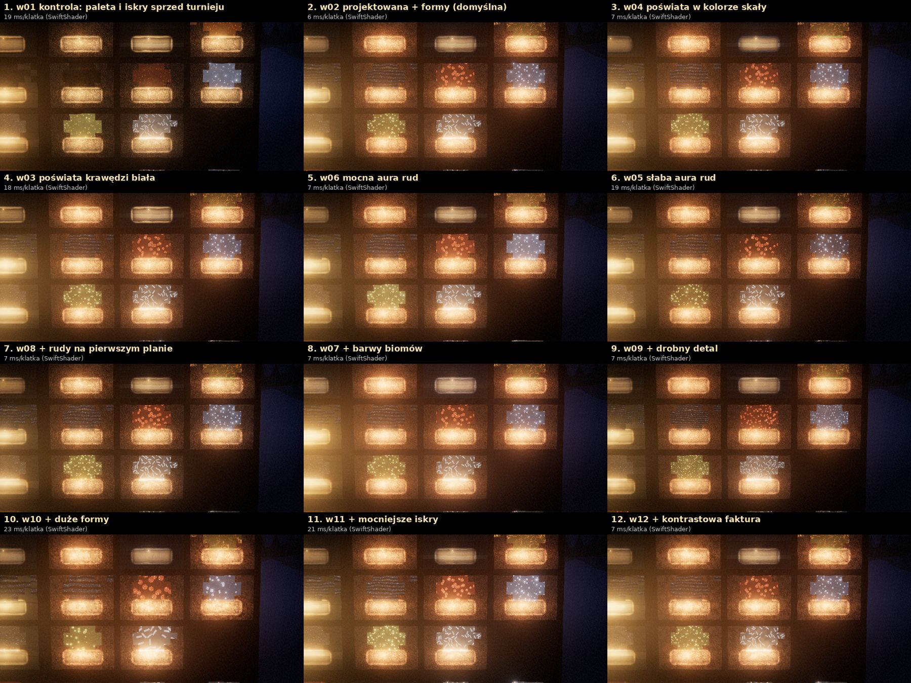

# Turniej nr 2 — materiały skał i złóż (paleta, wzory, czytelność rud)

**Zwycięzca: „Projektowana pełna + formy minerałów”** (wariant w02): paleta projektowana per biom dla
**44 materiałów** (26 złóż z biblii treści + skały macierzyste 9 biomów), **kształt złoża jako drugi nośnik
tożsamości** (7 form rud, 4 formy kryształów), osobny **kolor połysku** iskier, poświata krawędzi
w kolorze skały (0,7) i słaba aura żyły (0,08).

*Wiersze: noc — kontrola, noc — zwycięzca, światło robocze — kontrola, światło robocze — zwycięzca.
Kolumny: Wapienne Progi, Granitowe Korzenie, Kryształowe Głębie, Pas Magmy.*

## Pytanie turnieju
1. Każdy biom ma własny nastrój barwny (zejście w głąb = zmiana świata).
2. Gracz odróżnia materiały, które spotyka **w tym samym biomie** (inne kilofy, inne surowce) — także przy
   deuteranopii.
3. Złoże widać w ciemnym przekroju (styl R2B: lita skała to ciemna sylwetka).

## Przebieg (6 rund, 47 wariantów, ~1300 renderów)
| Runda | Co testowano | Wynik |
|---|---|---|
| 1–2 | 12 transformacji palety bazowej (m01–m12) + paleta projektowana m13, galeria 25 materiałów, światło robocze | m13 najlepsza średnia separacja; łańcuchy wariantów unieważnione przez błąd parsera (`+` w URL → spacja), poprawione i powtórzone |
| 3 | łańcuchy (m13+m09 barwy biomów itd.), ekspozycja skały | m13+m09: najsłabsza para skał ΔE 4,2 → 8,7 |
| 4 | arena, 8 scenariuszy: paleta × pochodnia × wzmocnienie wnętrz × iskry | **węgiel niewidoczny we wszystkich wariantach (ΔE 2–4)**, miedź traci kontrast w piaskowcu (30 → 21); jaśniejsza paleta wymaga słabszych pochodni |
| — | **zmiana zakresu**: tabela renderu miała 25 materiałów, biblia treści 26 złóż (brakowało m.in. cyny, galeny, siarki, soli, kobaltu, rubinu, adamantytu) | pełna tabela 44 materiałów powiązana z danymi treści, galeria biomów, metryki per biom, test palety |
| 5 | 12 wariantów na galerii biomów, noc + światło robocze (240 renderów) | wykryto: iskry na całym kaflu zlewały białe rudy (cyna, saletra, srebro, kwarc); poświata krawędzi była biała i myła kolor rud przy tunelach |
| 6 | **finał**: 12 wariantów (kontrola, zwycięzca, 2× poświata, 2× aura, 6 transformacji) × 10 ujęć × 2 oświetlenia | zwycięzca w02 (tabela niżej) |

## Narzędzia
- **Galeria biomów** (`lab.html?world=gallery`, `src/lab/gallery.ts`): 9 bloków 3×3; w bloku skały macierzyste
  jako próbki i każde złoże biomu jako żyła w głównej skale (dokładnie te pary, które gracz musi odróżnić);
  w każdej próbce wykop z pochodnią. Ujęcia: `g_all` (dzień) i `g_<biom>` (noc, same pochodnie).
- **Światło robocze** (`&flood=1`): równe światło wszędzie — ocenia samą paletę.
- **Metryki** `scripts/galmetrics.py` (CIE76 w Lab, średnie z próbek kafli): `host_min` — najbliższe dwie skały
  biomu, `ore_host` — żyła vs skała wokół niej, `ore_ore` — dwa złoża biomu; `_d` = symulacja deuteranopii
  (Machado 2009). Podsumowanie: najgorszy biom / średnia.
- **Test palety** `tests/palette.test.ts` (bez renderowania, `src/render/paletteCheck.ts`): estymacja średniej
  barwy materiału z pokrycia wzoru i formy; wszystkie pary w biomie ΔE ≥ 12, przy deuteranopii ≥ 7;
  mur krasnoludów ≥ 10 od każdej skały; każde złoże z biblii ma materiał o tej samej twardości i kilofie.

## Finał — wyniki
Światło robocze (sama paleta):

| Wariant | host_min min/śr | ore_host min/śr | ore_ore min/śr | host_d | ore_host_d | ore_ore_d |
|---|---|---|---|---|---|---|
| w01 kontrola (paleta i iskry sprzed turnieju) | 14,0 / 26,9 | 2,7 / 15,8 | **1,0** / 11,8 | 10,2 / 24,0 | 2,1 / 14,8 | **0,7** / 9,5 |
| **w02 projektowana + formy** | **24,3 / 36,2** | **5,3 / 17,9** | **8,2 / 13,9** | 22,7 / 32,2 | 5,3 / 16,4 | 3,0 / 11,3 |
| w03 poświata biała | 24,5 / 36,0 | 5,0 / 17,8 | 5,3 / 12,0 | 21,4 / 32,8 | 5,1 / 16,6 | 3,2 / 9,7 |
| w04 poświata w kolorze skały 1,0 | 23,8 / 36,0 | 5,0 / 17,7 | 7,8 / 14,3 | 23,1 / 32,3 | 4,9 / 16,2 | 3,2 / 11,8 |
| w05 aura 0,04 | 24,4 / 36,2 | 3,9 / 16,3 | 7,7 / 15,0 | 23,2 / 32,2 | 2,9 / 15,0 | 3,0 / 12,6 |
| w06 aura 0,14 | 24,4 / 35,8 | 5,4 / 19,1 | 2,2 / 12,3 | 22,9 / 31,9 | 5,6 / 17,5 | 2,0 / 9,6 |
| w07 + barwy biomów | 25,6 / **46,5** | 2,3 / 14,7 | 6,3 / 13,5 | 23,2 / 40,4 | 2,3 / 13,2 | 3,8 / 11,2 |
| w08 + rudy na pierwszym planie | 20,1 / 30,4 | 5,0 / 19,0 | 6,1 / 12,4 | 15,2 / 26,8 | 4,9 / 17,7 | 4,5 / 9,2 |
| w09 + drobny detal | 27,5 / 36,6 | 3,4 / 17,1 | 8,8 / 15,2 | 21,5 / 32,8 | 3,3 / 15,6 | 2,2 / 12,0 |
| w10 + duże formy | 21,2 / 34,1 | 5,9 / 19,1 | 4,4 / 13,9 | 18,9 / 30,5 | 5,7 / 17,4 | 3,4 / 11,9 |
| w11 + mocniejsze iskry | 23,9 / 35,2 | 5,7 / 18,6 | 2,2 / 12,3 | 22,1 / 31,5 | 5,9 / 17,0 | 2,2 / 10,2 |
| w12 + kontrastowa faktura | 26,3 / 36,1 | 4,2 / 17,5 | 3,6 / 12,5 | 24,8 / 32,5 | 4,3 / 16,1 | 2,6 / 9,9 |

Noc przy pochodniach (warunki gry): kontrola 3,3 / 2,3 / 9,2 (deut. ore_host **0,8**) → zwycięzca
6,3 / 5,1 / 5,8 (deut. ore_host 4,9). Mocniejsza aura (w06) podnosi średnią rud nocą (15,3), ale zlewa pary
rud przy daltonizmie (2,3) — odrzucona.

## Decyzje i reguły (obowiązują dla każdej nowej skały i rudy)
1. **Historia barw w głąb**: ciepła ziemia (Podgórze) → krem, ochra i szare łupki (Wapienne Progi) → łososiowy
   granit i niebieski łupek (Granitowe Korzenie) → fiolet pod turkusową grzybnią → czarno-zielony mokry mułowiec
   → zimny lawendowy łupek krystaliczny → czerń i ogień → śliwkowa ciemność i runy → karmazynowe serce.
2. **Rudy = matryca + akcent + forma + połysk.** Forma minerału jest drugim nośnikiem tożsamości (bramka E2:
   „nie tylko kolor”), unikalna w obrębie biomu:
   węgiel — **pokłady** (pasma z kliważem), miedź i srebro — **dendryty** rodzimego metalu, żelazo —
   **nerki** (skupienia groniaste), cyna i kobalt — **igły** w pękach, galena i adamantyt — **sześciany**,
   złoto, sfaleryt, saletra — **bryłki**, nikiel i lśnit — **pył** drobnych łusek, żaryt — **żarzące pasma**;
   kryształy: kwarc — **pryzmaty**, ametyst — **szczotka**, szafir i rubin — **heksagony**, mroźny kryształ — **odłamki**.
3. **Połysk ≠ akcent.** Iskry mają własny kolor (węgiel: szary metaliczny błysk, nie czarny), żyją tylko na
   ziarnach minerału; słaba aura (0,08) zaznacza całą żyłę w ciemności. Saletra jest matowa (brak iskier).
4. **Poświata krawędzi w kolorze skały** (`uRimTint` 0,7): rudy przy tunelach zachowują barwę.
5. Kontrast przy daltonizmie niesie **jasność**: pary o podobnym odcieniu rozsunięte w L* (np. kobalt jaśniejszy
   od srebra, grzybnia jaśniejsza od łupka zarodnikowego, rubin na jasnym marmurze zamiast w czerni).
6. Transformacje „barwy biomów” i „drobny detal” podnoszą rozróżnialność skał, ale zbliżają skały do rud —
   do ponownej oceny w turnieju światła (gradacja barwna sceny zamiast przebarwiania materiałów).

## Słabe punkty do drugiego przeglądu
- Cyna w wapieniu (ore_host 5,3) i miedź–cyna (8,2): cyna potrzebuje ciemniejszej matrycy albo większych igieł.
- Galena–kwarc przy deuteranopii (3,0): oba jasne nocą; rozważyć ciemniejszą galenę.
- Obsydian–bazalt (6,0): czarne szkło na czarnej skale — rozróżnia je dziś głównie połysk.
- Prakamień–prastary mur nocą (6,3): ruiny potrzebują własnego światła (runy) — wróci w turnieju dekoracji.
