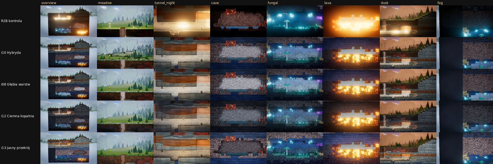
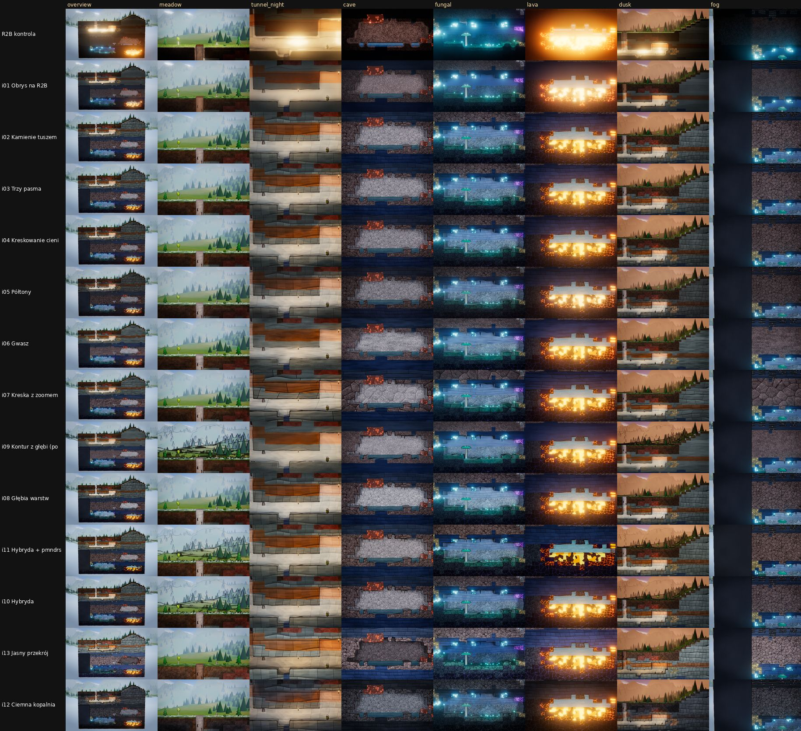
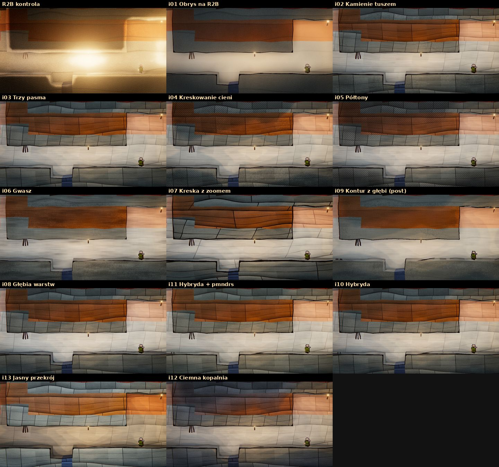
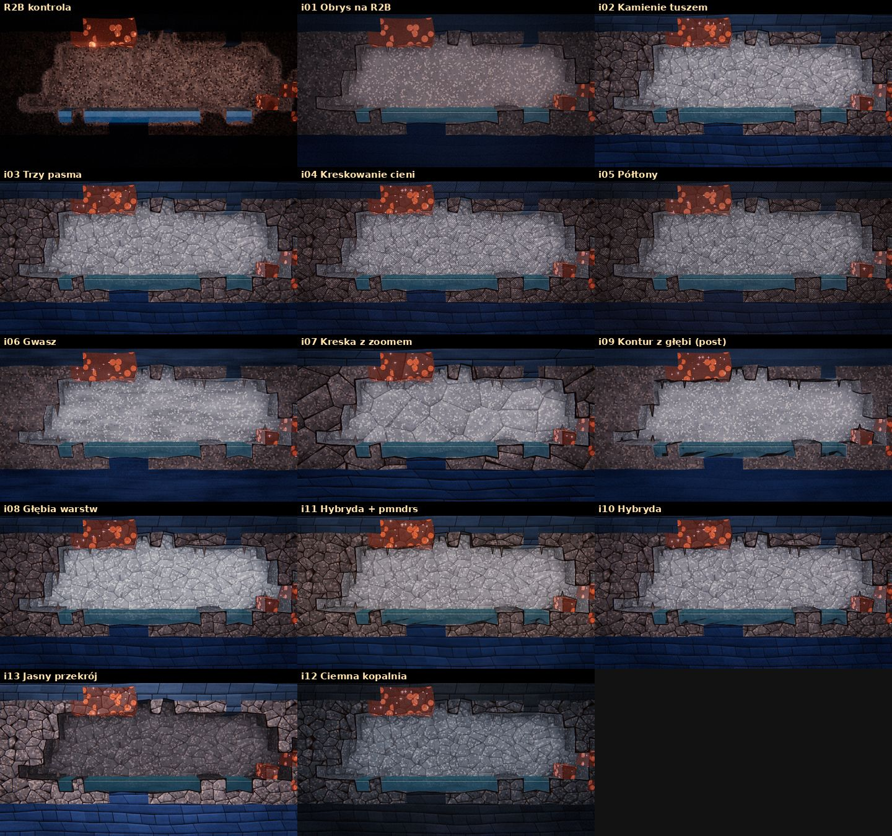
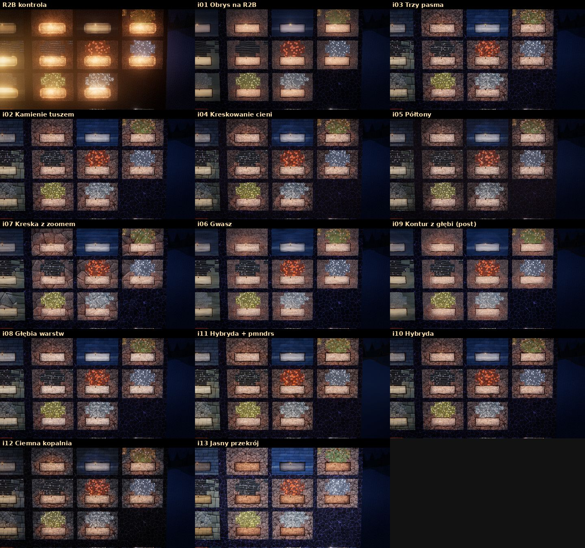
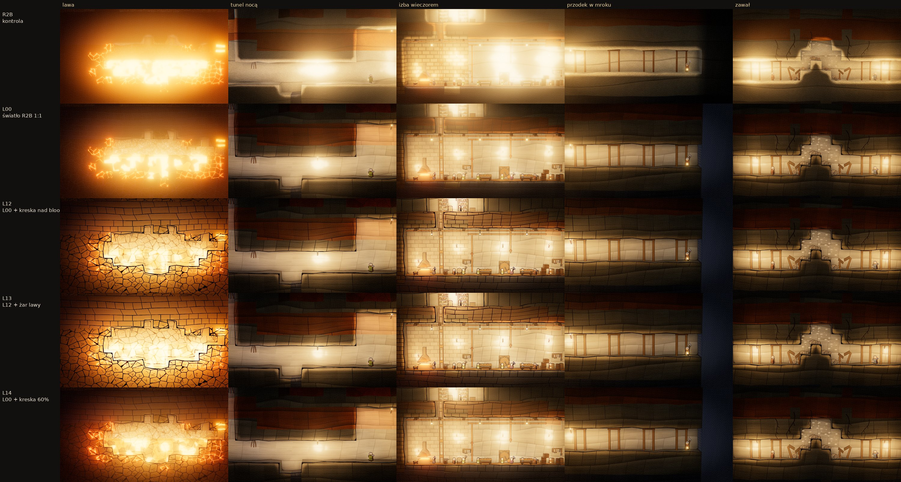

# Turniej nr 3 — styl ilustrowany przekroju 2.5D (runda 1)

**Status: runda 1 zakończona (13 wariantów + kontrola R2B), finaliści do rundy 2: i10 „Hybryda”, i08 „Głębia
warstw”, i12 „Ciemna kopalnia”.** Zwycięzcy jeszcze nie ma — runda 2 dopracuje finalistów parametrami biblii
sztuki v1.1 (`docs/art/ART-BIBLE.md` §0) i oceni je w trzech scenach tonu (CHARTER §4).


*Wiersze: R2B (kontrola), i10, i08, i12 oraz i13 (dawca planu wartości do rundy 2). Kolumny: 8 scenariuszy areny.*

## 1. Pytanie i protokół

Jak narysować przekrój góry w rodzinie stylu z referencji właściciela (gruby nierówny kontur, płaskie plamy
z fakturą, przygaszona paleta, ciepłe plamy światła), trochę ciemniej, z głębią 2.5D — i nie zgubić czytelności
przekroju i rud wypracowanej w turniejach nr 1 i 2.

- **Kod**: jeden parametryczny renderer `src/lab/styles/illustrated.ts` (+ zawodnik biblioteczny
  `illustratedPmndrs.ts`), wspólne helpery GLSL/TS w `src/render/ink.ts`, atrybut krawędzi `aEdge` w mesherze
  `src/render/heightfield.ts`. Wariant = zestaw parametrów (dane), cechy niewykorzystane wycinane `#define`.
  Paleta turnieju nr 2 nietknięta — korekty wartości są transformacją na poziomie stylu.
- **Sceny**: 8 scenariuszy areny (`overview`, `meadow`, `tunnel_night`, `cave`, `fungal`, `lava`, `dusk`, `fog`)
  + 10 ujęć galerii materiałów (`g_all` w dzień, 9 biomów nocą przy pochodniach). 960×540, te same kamery.
- **Zamrożony build**: wszystkie rendery z jednego builda laboratorium (`vite build` → statyczny serwer), więc
  przeładowania HMR od pracy innych agentów nie mogły skazić przebiegu. Sprawdzone: żądany id stylu == id
  wyrenderowany (BUG-001 nie wystąpił), 0 błędów konsoli. 252 rendery.
- **Metryki**: `scripts/metrics.py` (C_open, C_fog, dE_ore, dE_deut), `scripts/refstats.py` (L*, czerń,
  chroma, krawędzie, kreska) + **udział pikseli C\* > 30** (nowe kryterium wizji, liczone dodatkowo),
  `scripts/galmetrics.py` (rozróżnialność materiałów), czas klatki.
- **Cele per kontekst** (CHARTER §4, wizja v1), przypisanie scen w rundzie 1 (sceny tonu jeszcze nie istnieją —
  zadanie F2-12, tu przybliżenie): **gród oświetlony** = `tunnel_night` (≈ przodek w mroku), `dusk` i `meadow`
  (≈ izba wieczorem): L* 36–40 · czerń 15–22% · chroma 13–18 · krawędzie ≥ 15% · kreska ≥ 3% · C\*>30 ≤ 8%;
  **odkryta dzika głębia** = `cave`, `fungal`, `lava`, `fog`: L* ≥ 26 · czerń ≤ 30% · kreska ≥ 3%.
  `overview` — informacyjnie. Sceny „zawał” brak.
- **Czas klatki**: odstęp `requestAnimationFrame` (10 klatek po 8 rozgrzewkowych, `overview` + `tunnel_night`),
  SwiftShader na CPU — **tylko względnie**. Wbudowane `frameMs` laboratorium mierzy czas wysłania komend, nie GPU
  (BUG-002) — nie używać go do oceny.
- **Rubryka** (CLAUDE.md): czytelność 25, wow 25, atmosfera 15, spójność (wizja + słownik znaczeń) 10,
  skalowalność treści 10, wydajność 10 (względem najtańszego), oryginalność 5.
- **Audyt QA po przebiegu** (`tests/qa/lab-audit.mjs`, `SHOTS=0 STABILITY=1`, 13 stylów + R2B × 8 scen):
  0 błędów i ostrzeżeń, brak podmiany stylu; maks. udział zgniecionej czerni (L* < 6) 11–21% wobec 57% w R2B
  (i01 i i11: 27%); kreska w spoczynku stabilna — zmiana pikseli tuszu w 1 s ≤ 0,9% (płyny, niebo, wiatr),
  i09 1,6%, i11 3,4% (animowane ziarno pmndrs).

## 2. Warianty rundy 1

Wspólny „język mapy mierniczego” (zbieżny z biblią sztuki §1): **ławice i spękania** w skałach warstwowych
(zgodne z pasami palety), **bloki z rysami** w skałach masywnych i matrycach rud, **punktowanie i otoczaki**
w gruncie, **spoiny** w murze; ta sama struktura cieńszym „ołówkiem” na tylnych ścianach. Kontur skała/pustka
liczony dokładnie z geometrii (maska sąsiadów + współrzędne kafla), stały w pikselach, nierówny, w spoczynku
nieruchomy. Nieznane = gęste kreskowanie z obwódką tuszu. Formy minerałów obrysowane kreską detalu, błysk rudy
jako rysowana gwiazdka. Rekwizyty i krasnoludy: płaska barwa w dwóch tonach + obrys skorupy o stałej grubości.

| id | Nazwa | Co wyróżnia propozycję |
|---|---|---|
| R2B | kontrola | zwycięzca turnieju nr 1 (poświata, bloom, świecące powietrze) |
| i01 | Obrys na R2B | minimalna zmiana: nastrój R2B + kontur, warga ścian, obrys rekwizytów |
| i02 | Kamienie tuszem | struktura skały tuszem, gładkie światło, lekka posteryzacja |
| i03 | Trzy pasma | baza: 3 miękkie pasma światła, ciepło na chłodnym tle, jaśniejsze tła wnęk |
| i04 | Kreskowanie cieni | 2 pasma + kreskowanie w cieniu (krzyżowe w najgłębszym mroku), papier |
| i05 | Półtony | 3 pasma + raster półtonowy w cieniach, nasycenie 1,0 |
| i06 | Gwasz | gładkie światło, mocny pędzel, posteryzacja, cienka drżąca kreska, bez struktury |
| i07 | Kreska z zoomem | grubość 0,09 kafla (1,5–5 px), duże bryły — test przeciw „stałej w pikselach” |
| i08 | Głębia warstw | jasne chłodne tła z warstwami, linia styku tła ze ścianami, ciemne boki wnęk |
| i09 | Kontur z głębi | kreska tylko z bufora głębi w post (Laplasjan), także rekwizyty i krajobraz |
| i10 | Hybryda | kontur + struktura w shaderze terenu, kontur z głębi w post dla rekwizytów/postaci/krajobrazu |
| i11 | Hybryda + pmndrs | scena i10, post z `postprocessing` 6.39.6 (jeden scalony `EffectPass`) |
| i12 | Ciemna kopalnia | niski ambient, 4 pasma, mrok mocno zabiera kolor, kreska 3 px |
| i13 | Jasny przekrój | lico jasne jak papier przekroju, wnęki ciemniejsze z ciepłymi plamami |



## 3. Wyniki — arena (8 scenariuszy)

Kontekst gród: L* / czerń % / chroma / krawędzie % / kreska % / C\*>30 %; głębia: L* / czerń % / kreska %.
„Trafienia” = odsetek par (ujęcie, cel kontekstu) spełnionych. ms = SwiftShader, względnie.

| id | gród | cele grodu | głębia | cele głębi | trafienia | C_open | C_fog | dE_ore | dE_deut | ms |
|---|---|---|---|---|---|---|---|---|---|---|
| R2B | 45,1 / 20,6 / 20,8 / 1,9 / 0,2 / 27,0 | 1/6 | 28,9 / 43,0 / 0,7 | 1/3 | 20% | **0,493** | 0,401 | 25,6 | 23,9 | 230 |
| i01 | 39,7 / 20,3 / 14,0 / 2,5 / 0,9 / 8,0 | **4/6** | 28,2 / 36,0 / 0,5 | 1/3 | 30% | 0,450 | 0,310 | 26,3 | 25,2 | 205 |
| i02 | 42,5 / 13,9 / 15,6 / 5,2 / 1,9 / 18,8 | 1/6 | 28,4 / 35,8 / 2,3 | 1/3 | 40% | 0,429 | 0,357 | 28,3 | 26,8 | 243 |
| i03 | 42,4 / 14,1 / 15,6 / 5,2 / 1,9 / 19,1 | 1/6 | 28,0 / 36,8 / 2,3 | 1/3 | 37% | 0,431 | 0,356 | 28,4 | 27,0 | 225 |
| i04 | 41,4 / 18,0 / 15,4 / 6,1 / 2,2 / 18,1 | 2/6 | 26,9 / 40,0 / 2,2 | 1/3 | 33% | 0,468 | 0,312 | 28,4 | 26,9 | 230 |
| i05 | 40,8 / 20,6 / 12,6 / 5,2 / 2,0 / **5,4** | 2/6 | 25,8 / 42,5 / 1,7 | 0/3 | 37% | 0,484 | 0,279 | 26,0 | 24,7 | 229 |
| i06 | 43,2 / 11,4 / 15,4 / 2,9 / 0,9 / 17,9 | 1/6 | 30,0 / 32,1 / 1,1 | 1/3 | 27% | 0,411 | 0,406 | 28,8 | 27,3 | **199** |
| i07 | 42,3 / 14,5 / 15,4 / 5,2 / 2,0 / 18,7 | 1/6 | 28,4 / 35,5 / 1,6 | 1/3 | 37% | 0,423 | 0,373 | 28,6 | 27,0 | 215 |
| i08 | 43,0 / 14,1 / 15,0 / 5,5 / 2,0 / 17,4 | 1/6 | 29,4 / 36,5 / 2,3 | 1/3 | 33% | 0,475 | 0,355 | 28,5 | 27,0 | 213 |
| i09 | 40,7 / 15,1 / 14,7 / 5,8 / 2,1 / 17,1 | 2/6 | 28,6 / 34,5 / 1,2 | 1/3 | 40% | 0,402 | 0,401 | 28,8 | 27,3 | 229 |
| i10 | 40,8 / 16,4 / 15,1 / 8,1 / **3,1** / 17,8 | 3/6 | 27,5 / 37,6 / 2,5 | 1/3 | **43%** | 0,428 | 0,356 | 28,6 | 27,1 | 242 |
| i11 | 44,9 / 11,8 / 16,3 / **9,0** / **3,3** / 20,3 | 2/6 | 25,3 / 42,1 / **4,2** | 1/3 | **43%** | 0,403 | 0,328 | **31,1** | **29,2** | 212 |
| i12 | 40,2 / 17,6 / 13,3 / 4,8 / 1,9 / 15,7 | 2/6 | 25,3 / 41,0 / 1,9 | 0/3 | 27% | 0,432 | 0,263 | 26,9 | 25,2 | 223 |
| i13 | 46,9 / 4,8 / 18,5 / 6,8 / 2,0 / 21,9 | 0/6 | **31,6 / 20,2 / 3,2** | **3/3** | **43%** | 0,126 | **0,516** | 28,5 | 26,7 | 221 |

Najważniejsze obserwacje:
- **Kreska**: R2B 0,2% → warianty ze strukturą skały 1,9–3,3% w grodzie i do 4,2% w głębi; scena przeglądu
  3,4–3,9%. Cel ≥ 3% osiągają i10/i11 w grodzie i i13/i11 w głębi.
- **Krawędzie**: maks. 9% (gród) i 13–15% w scenach skalnych i13 — **cel ≥ 15% nieosiągnięty**. Przyczyna
  strukturalna: arena to puste tunele (pochodnie, 4 manekiny); referencja ma 29% głównie dzięki gęstym
  maszynom, rurom i drabinom. Biblia sztuki §0 („gęstość rysunku ≥ 1,1 kafla linii/kafel²”) przenosi część
  celu na budowle — runda 2 doda sceny tonu z zastawioną izbą.
- **Nasycenie**: R2B ma 27% pikseli C\*>30 (lampa barwi kadr). Warianty z gradacją nasycenia 1,15 mają 17–20%
  (zmierzch i plamy pochodni), i05 z nasyceniem 1,0 — 5,4% (cel ≤ 8%). Wniosek: nasycenie gradacji 1,0
  i barwa lampy tylko w rdzeniu plamy.
- **Czytelność przekroju nie spadła drastycznie**: C_open 0,40–0,48 (R2B 0,49) we wszystkich wariantach z ciemnym
  licem; dE_ore **wzrosło** z 25,6 do 26–31 (obrys form + rysowane błyski). Wyjątek: i13 (jasne lico) — C_open 0,126,
  bo w mroku lico i tylna ściana mają podobną jasność; za to najlepsze C_fog (0,516) i cele głębi 3/3.
- **Głębia**: L* ≥ 26 osiąga większość wariantów (cave 22–28, fungal 27–31), ale czerń 32–43% (cel ≤ 30%) — ciemne
  łupki i bazalty plus scena `fog` zdominowana przez nieznane (czerń dozwolona słownikiem) zawyżają średnią.




## 4. Wyniki — galeria materiałów (9 biomów nocą)

`galmetrics.py` (ΔE CIE76 z próbek kafli; min / średnia; `_d` = deuteranopia):

| id | host_min | ore_host | ore_ore | host_min_d | ore_host_d | ore_ore_d |
|---|---|---|---|---|---|---|
| R2B | 8,9 / 24,0 | 4,2 / 13,3 | **5,5** / 16,4 | 6,5 / 20,2 | 4,4 / 10,2 | **4,9** / 10,1 |
| i01 | 16,7 / 28,2 | 4,2 / 14,8 | 2,6 / 16,8 | 16,3 / 24,5 | 4,4 / 11,9 | 1,5 / 8,7 |
| i02 | 24,4 / 31,1 | 4,0 / 17,5 | 4,1 / 16,1 | 19,7 / 27,3 | 3,7 / 14,4 | 3,3 / 9,0 |
| i03 | 24,1 / 30,3 | 6,8 / 17,5 | 3,4 / 15,9 | 19,3 / 26,7 | 6,4 / 14,6 | 2,4 / 9,0 |
| i04 | 22,0 / 29,3 | 7,4 / 17,0 | 2,9 / 16,2 | 17,2 / 25,5 | 7,1 / 13,8 | 2,1 / 8,9 |
| i05 | 18,4 / 24,2 | **8,5** / 14,9 | 1,7 / 14,9 | 14,9 / 21,0 | 6,9 / 12,5 | 0,8 / 7,9 |
| i06 | 24,9 / 34,4 | 3,2 / 18,7 | 5,0 / 16,3 | 24,1 / 30,2 | 3,2 / 15,2 | 3,4 / 9,3 |
| i07 | 25,1 / 32,8 | 3,3 / 18,6 | 3,3 / 15,6 | 21,1 / 28,8 | 3,0 / 15,5 | 1,5 / 9,5 |
| i08 | 23,9 / 31,2 | 5,8 / 17,4 | 3,3 / 15,5 | 19,2 / 27,5 | 5,4 / 14,6 | 1,8 / 8,9 |
| i09 | 24,8 / 33,8 | 4,5 / 18,9 | 4,5 / 16,2 | 23,4 / 29,7 | 4,4 / 15,4 | 3,5 / 9,4 |
| i10 | 24,0 / 31,0 | 3,8 / 17,3 | 3,6 / 16,1 | 19,2 / 27,2 | 3,5 / 14,4 | 2,4 / 9,5 |
| i11 | 25,2 / 34,1 | 3,0 / 19,0 | 2,7 / 14,1 | 21,7 / 29,0 | 2,8 / 15,5 | 2,6 / 8,9 |
| i12 | 13,9 / 22,4 | 6,1 / 14,1 | 2,2 / 16,1 | 10,7 / 19,0 | 5,2 / 12,1 | 1,2 / 8,2 |
| i13 | **29,6 / 38,1** | 1,7 / **19,5** | 3,6 / 16,0 | **26,7 / 33,9** | 1,2 / 15,2 | 2,2 / **10,7** |

Styl ilustrowany **wyraźnie poprawia rozróżnianie skał** (host_min 8,9 → 22–30) i średnią rudy względem skały,
ale **najsłabsza para ruda–ruda spada** (5,5 → 1,7–5,0; przy deuteranopii 4,9 → 0,8–3,5). Przyczyna:
kompresja jasności palety (`valueComp` 0,5) i odbarwianie w mroku zjadają różnicę jasności, która w turnieju nr 2
niosła pary dla daltonistów (reguła 5). Do rundy 2: `valueComp` ≤ 0,3 i wyłączenie akcentów rud z kompresji
(biblia §0: „akcenty rud bez gradacji”). Kadry galerii mają 53–71% czerni, bo ok. połowę kadru zajmuje
nieoświetlone otoczenie bloków — refstats galerii nie porównujemy z celami.



## 5. Ocena wg rubryki

| id | czytelność 25 | wow 25 | atmosfera 15 | spójność 10 | skalowalność 10 | wydajność 10 | oryginalność 5 | **ocena** | decydująca obserwacja |
|---|---|---|---|---|---|---|---|---|---|
| i10 | 8,0 | 7,5 | 6,5 | 8,5 | 8,5 | 8,2 | 7,5 | **7,74** | jedna kreska dla terenu, rekwizytów i krajobrazu; najlepsze cele grodu (3/6), kreska 3,1% |
| i08 | 8,0 | 7,0 | 6,5 | 8,0 | 7,5 | 9,3 | 7,5 | **7,58** | najlepsza czytelność 2.5D wśród ilustrowanych (C_open 0,475): linia styku tła, ciemne boki wnęk |
| i12 | 6,5 | 7,5 | 8,5 | 7,5 | 7,0 | 8,9 | 7,0 | **7,47** | najlepszy nastrój nocy, „mrok zabiera kolor, nie kształt”; głębia za ciemna |
| i03 | 7,5 | 7,0 | 6,5 | 8,0 | 7,5 | 8,8 | 7,0 | 7,38 | baza; tła tunelu za jasne w plamie lampy |
| i02 | 7,5 | 7,0 | 6,5 | 7,5 | 7,5 | 8,2 | 7,0 | 7,27 | jak i03 z gładkim światłem |
| i13 | 6,5 | 7,5 | 6,0 | 8,0 | 7,5 | 9,0 | 8,0 | 7,25 | plan wartości biblii (lico jaśniejsze od tła w mroku), najwięcej krawędzi; C_open 0,126 |
| i11 | 6,5 | 7,0 | 6,5 | 7,5 | 8,0 | 9,4 | 7,5 | 7,21 | jak i10, ale artefakt w lawie; +12,3 KB gzip |
| i06 | 6,5 | 6,5 | 7,0 | 6,0 | 7,0 | 10,0 | 6,0 | 6,90 | malarsko, mało rysunku (kreska 0,9%) |
| i07 | 7,5 | 7,0 | 6,5 | 4,0 | 6,0 | 9,2 | 7,0 | 6,87 | kreska grubiejąca z zoomem — sprzeczna z wizją |
| i05 | 7,0 | 6,5 | 6,5 | 6,0 | 7,0 | 8,7 | 6,0 | 6,82 | półtony; najniższe C\*>30, głębia za ciemna |
| i04 | 7,0 | 7,0 | 7,0 | 3,5 | 7,0 | 8,6 | 7,0 | 6,81 | kreskowanie cieni myli się z nieznanym (słownik) |
| i01 | 6,5 | 5,5 | 6,5 | 4,0 | 8,0 | 9,7 | 5,0 | 6,39 | świecące powietrze i bloom R2B odrzucone w wizji |
| i09 | 6,0 | 5,5 | 6,5 | 6,0 | 8,0 | 8,7 | 5,0 | 6,37 | sama kreska z głębi: cienka, bez struktury skały |
| R2B | 5,0 | 6,0 | 6,5 | 2,5 | 7,0 | 8,6 | 5,0 | 5,79 | olśnienie i mgła bloomu, kreska 0,2%, C\*>30 27% |

Warianty-dowody (świadomie sprzeczne ze słownikiem, potwierdziły decyzje wizji): i04 (kreskowanie w cieniu czyta
się jak nieznane), i07 (kreska rosnąca z zoomem jest ciężka w zbliżeniu), i01 (poświata R2B rozmywa kontur).

## 6. Finaliści i plan rundy 2

1. **i10 Hybryda** — szkielet zwycięzcy: kontur i struktura skały w shaderze terenu (dokładne, tanie, w przestrzeni
   świata), kontur z bufora głębi dla wszystkiego, co nie jest terenem (rekwizyty, postacie, przyszłe budowle,
   krajobraz) — jedna kreska bez osobnych skorup dla każdego modelu.
2. **i08 Głębia warstw** — najlepsza czytelność 2.5D: linia styku tylnej ściany ze ścianami bocznymi, ciemne boki
   wnęk, warstwy skały na tłach (nie płaska tapeta).
3. **i12 Ciemna kopalnia** — nastrój nocy i „mrok zabiera kolor, nie kształt”, 4 pasma ciepłego światła.

Każdy finalista dostaje w rundzie 2 parametry biblii sztuki §0: wagi kreski W1 4 px / W2 3 / W3 2 / Wd 1,25 px
przy 1080p (×H/1080), nierówność ±20%, tusz `#201812`; **plan wartości z i13** (płaszczyzna cięcia w mroku
22–48 L*, tylna ściana = cięcie −14, w plamie lampy 44–46), kolano świateł (`tanh`), plama = rdzeń 0,35 R + halo,
bloom tylko na emiterach (próg L* ≥ 85), nasycenie gradacji 1,0, `valueComp` ≤ 0,3 z akcentami rud poza
kompresją, ambient per biom. Ocena w trzech scenach tonu (F2-12) i na 2 seedach (D4), z kontrolą C_open ≥ 0,35,
dE_ore ≥ R2B i ore_ore_d ≥ 3.

**Zawodnik biblioteczny (i11, pmndrs/postprocessing 6.39.6)**: licencja **Zlib** (permisywna; lista w CLAUDE.md
ją dopuszcza). Koszt paczki użytego podzbioru: **73,6 KB min / 17,0 KB gzip** wobec 19,4 / 4,7 KB naszego łańcucha
z `three/addons` (+54 KB / +12,3 KB gzip). Czas klatki **−13% wobec i10** (212 vs 242 ms w SwiftShaderze:
scalony `EffectPass`, tańszy bloom mipmapowy). Obraz: **artefakt w scenie lawy** (czarne bloki i turkusowy
prostokąt — prawdopodobnie wartości NaN/ujemne w scalonym łańcuchu efektów; do diagnozy) i jaśniejszy kadr.
Nie przechodzi do finału jako całość; **wniosek do rundy 2**: scalić nasze przejścia post (kreska z głębi +
gradacja w jednym shaderze, bloom mipmapowy) — zysk wydajności bez zależności.

## 7. Dokumentacja silnika (potok, koszty, skalowanie)

### 7.1 Architektura i miejsce w potoku
- **CPU (raz na zmianę świata)**: mesher `buildHeightfield` emituje dodatkowy atrybut `aEdge` (vec4/wierzchołek):
  pokrywa kafla — lokalne (u, v) i maska 8 sąsiadów różniących się stałością; ściany — t (tył→przód), rozpiętość
  głębokości, flaga „przód w płaszczyźnie cięcia”. Koszt: +16 B/wierzchołek, zero dodatkowych przebiegów.
  Rekwizyty: geometria skorupy z zespawanymi normalnymi (`hullGeometry`) liczona raz na typ.
- **GPU, przebieg sceny (MSAA 4×, HalfFloat)**: teren — jeden `ShaderMaterial` (struktura skały, światło w pasmach,
  kontur, nieznane, papier); rekwizyty — płaska barwa dwutonowa + (opcjonalnie) instancjonowana skorupa
  `BackSide` z przesunięciem w przestrzeni klipu (stała grubość w px); płyny — własny materiał z linią powierzchni.
- **GPU, post**: (opcjonalnie) `DepthInkPass` — kreska z głębi (9 próbek głębi + 2 próbki szumu/piksel), następnie
  UnrealBloom (tylko emitery), gradacja, ACES + sRGB. Obie tekstury bufora kompozytora mają `DepthTexture`
  (bufor odczytu zamienia się między klatkami).
- **Konfiguracja**: `IllParams` (dane) → uniformy + `#define`; nic nie wymaga przebudowy potoku.

### 7.2 Algorytm i kompromisy
- **Kontur dokładny do geometrii zamiast izolinii `fogAt().y`**: izolinia mgły rozjeżdża się z poszarpaną
  geometrią i ma przerwy w narożnikach wklęsłych; odległość od krawędzi z `aEdge` (pasy po bokach + dyski
  w narożnikach wklęsłych, zaokrąglenie wypukłych) jest ciągła między kaflami i dokładna. Szerokość w px:
  `w = px · worldPerPixel`, gdzie `worldPerPixel = (z_kamery − z) · 2·tan(fov/2)/H` — analitycznie, bez
  pochodnych (stabilne, bez migotania).
- **Struktura skały z LOD oktawowym**: bloki Voronoi przenikają między oktawą s i 2s, gdy na ekranie byłyby
  gęstsze niż ~22 px; spękania ławic przełączają długość potęgami 2 (prosto, ale skok przy zoomie — do poprawy
  przenikaniem); kreskowanie/półtony mają oktawy zagnieżdżone (grubsza jest podzbiorem drobniejszej) — bez pyknięć.
- **Bump usunięty** (2 wywołania `heightAt` mniej) — płaski rysunek go nie potrzebuje; zwolniony budżet ALU
  przeszedł na strukturę skały, dlatego ms wariantów ≈ R2B (199–243 vs 230).
- **Kompromis jakość/koszt**: kontur w shaderze terenu jest tani (kilka porównań), ale działa tylko dla terenu;
  kontur z głębi łapie wszystko (także przyszłe budowle), kosztem pełnoekranowego przebiegu i cieńszej, mniej
  „ręcznej” linii — stąd hybryda (i10).

### 7.3 Parametry i progi skalowania
| Parametr | Typ | Wpływ na obraz / wydajność | Zakres / skalowanie |
|---|---|---|---|
| `inkPx` (W1) | px ekranu | grubość konturu skała/pustka | 2–5 px @1080p (biblia 4); ×1,5 tryb „mocna kreska” |
| `inkWorld`, `inkMaxPx` | kafle / px | kreska rosnąca z zoomem (i07) | 0 = stała w px (wizja) |
| `wobble` | 0..1 | nierówność linii (szum świata) | 0,2–0,45; `boil` = 0 w spoczynku |
| `chunk`, `chunkInk` | kafle / ułamek W1 | gęstość i grubość struktury skały; 1–2 Voronoi/fragment | 0,8–1,7 kafla; LOD sam przełącza oktawy |
| `backStruct`, `backInk`, `lip` | 0..1 | ołówek na tłach, linia styku, warga ścian | jakość niska: `backStruct` 0 |
| `bands`, `bandSoft` | 0/2–4, 0..0,5 | pasma światła | 3 / 0,14 |
| `cutAmb`, `backAmb`, `cutLight`, `backLight`, `sideDark` | skalary | plan wartości (L* lica, tła, boków) | wg biblii §0 (runda 2) |
| `valueComp`, `valueTarget` | 0..1, lum | ścisk jasności palety | ≤ 0,3 (pary rud!) |
| `darkDesat`, `desat`, `lightDesat`, `saturation` | 0..1 | „mrok zabiera kolor”, chroma, C\*>30 | nasycenie 1,0 |
| `hatch`, `halftone`, `markPx` | 0..1, px | znaki cienia (+1 funkcja/fragment) | wyłączone (słownik) |
| `fogHatch`, `fogHatchPx` | 0..1, px | kreskowanie nieznanego | 0,8 / 6 px |
| `hullPx`, `hullDwarfPx` | px | obrys skorupy (+1 draw call/typ rekwizytu) | 1,5 / 2,2; 0 przy kreskach z głębi |
| `postInk`, `postInkPx` | 0..1, px | kreska z głębi (+1 przebieg pełnoekranowy, 9 próbek) | jakość niska: połowa rozdzielczości |
| `paper` | 0..1 | ziarno papieru w przestrzeni świata | 0,06–0,12, wygaszane przy oddaleniu |
| `bloom*`, `exposure` | | tylko emitery | próg 0,85; promień ≤ 0,6 |

### 7.4 Szkic shadera (kontur + struktura)
```glsl
float wpp = max(uCamPos.z - wp.z, 0.5) * uPxScale;          // world units per pixel (analytic)
float wE  = clamp(uInkW.y / wpp, uInkW.x, uInkW.z) * wpp     // width: px -> world
          * max(0.3, 1.0 + uWobble * wobbleNoise(wp.xy));    // static hand wobble (no boil at rest)
float aa  = 0.75 * wpp;
float ink = cut ? inkLine(edgeDistance(vEdge, int(vMask + 0.5), uRound), wE, aa) : 0.0;
RockInk rk = rockInk(pat, wp.xy, p3.x, wpp, uChunk, wE * uChunkInk, aa); // beds/joints, blocks/cracks...
ink = max(ink, max(rk.lines, 0.85 * rk.fine));
col = mix(col, inkColour, ink);                               // ink over light, under the drawn glints
```

### 7.5 Wąskie gardła, artefakty, profilowanie
1. **ALU fragmentów terenu** (Voronoi ×1–2 w strukturze + `surface()` + 12 świateł dynamicznych): wąskie gardło
   przy pełnoekranowym przekroju. Mitygacja: `#define` wycina nieużywane cechy, LOD wyłącza drobne znaki,
   jakość niska = bez ołówka na tłach i bez drugiej oktawy Voronoi. Pomiar: czas GPU per materiał
   (`EXT_disjoint_timer_query_webgl2` na docelowym GPU), widok debug „tylko struktura”.
2. **Aliasing i migotanie cienkich linii** przy oddaleniu: szerokości w px z analitycznym `worldPerPixel`,
   antyaliasing 0,75 px, wygaszanie znaków < 10–22 px odstępu. Pomiar: test STABILITY z `lab-audit.mjs`
   (udział zmienionych pikseli tuszu między klatkami w spoczynku).
3. **Pyknięcia LOD przy zoomie** (spękania ławic przełączane skokowo): do zamiany na przenikanie oktaw jak
   w blokach. Pomiar: nagranie przejazdu kamery d 16→92, różnica klatek.
4. **Przebiegi post i pamięć**: `DepthInkPass` czyta głębię MSAA (resolve) — przy 1080p ~8 MB na `DepthTexture`
   ×2 bufory; scalenie kreski z gradacją usunie jeden przebieg (lekcja z pmndrs: −13% czasu). Pomiar: liczba
   przebiegów i `renderer.info` (wywołania, trójkąty) per klatka.
- **Uwaga pomiarowa (BUG-002)**: `frameMs` laboratorium mierzy wysłanie komend (~1 ms), nie GPU; w tym turnieju
  ms to odstęp rAF w SwiftShaderze (198–243 ms) — wiarygodny tylko względnie. Pomiar bezwzględny: zapytania
  czasowe GPU lub `gl.finish()` w pętli pomiarowej (zadanie po rundzie 1).

## 8. Znane braki i ryzyka
- Krawędzie ≥ 15% nieosiągnięte w pustych scenach — potrzebne sceny tonu z zastawioną izbą (F2-12).
- Najsłabsze pary ruda–ruda przy deuteranopii spadły (patrz §4) — warunek rundy 2.
- Tylne ściany tuneli w plamie lampy za jasne: średnio 58–68 L*, 90. percentyl 72–81 (i10/i08/i12; R2B 75/93)
  zamiast 44–46 z biblii — kolano świateł w rundzie 2. Lico skały w tym ujęciu: 25–27 L* (i13: 42).
- Niebo i krajobraz bez stylizacji (osobny turniej); w i09–i11 krajobraz dostaje kreskę z głębi.
- Woda rysowana jako płaska płyta; lawa poprawna tylko w naszym łańcuchu post.
- Rendery surowe: `/tmp/underhearth-engine/t3r1` (arena), `t3r1g` (galeria); dane: `round1_analysis.json`,
  `round1_bench.json` w katalogu plansz.

---

# Runda 2 (w toku)

## R2-A. Poprawki laboratorium (QA)
| Zgłoszenie | Poprawka | Dowód |
|---|---|---|
| BUG-001 | `src/lab/params.ts`: walidacja `style`, `scenario`, `world`, `seed`; nieznany id = błąd w HUD, `window.__labError`, wyjątek strony (bez cichego fallbacku). `__lab.styleId`/`scenarioId` = to, co faktycznie wyrenderowano; `setScenario` z nieznanym id odrzuca obietnicę. `scripts/tournament.mjs` czeka na `__lab` albo `__labError`, porównuje id stylu i scenariusza każdego renderu i przerywa przebieg (kod 1) przed utworzeniem katalogu wariantu. | `tests/lab/lab-params.test.ts` |
| BUG-002 | `src/lab/frametime.ts`: `__lab.measure(n, warmup)` — `EXT_disjoint_timer_query_webgl2` (czas GPU), a bez rozszerzenia render ujęty w `gl.finish()`; wynik ma pole `method`, min/p50/p95/średnia. `__lab.frameMs` = p50 próbek `gl.finish()` po zmianie scenariusza (bez klatek kompilacji), `__lab.frameMethod`. | test statystyk w `tests/lab/lab-params.test.ts` |
| BUG-005 | `WorldTex`: nieodkryty kafel bez `bg` dostaje ten sam fallback co mesher (wapień), nigdy prawdziwy materiał. | `tests/qa/render-data.test.ts` (`it.fails` → `it`) |
| D4 | parametr `seed` dla `arena`, `gallery` i `tone` (domyślne: 777, 4242, 1); `__lab.seed`. | `tests/lab/lab-params.test.ts` |

## R2-B. Sceny tonu (F2-12)
`lab.html?world=tone&scenario=izba|przodek|zawal[&seed=N]` — `src/lab/toneScenes.ts`, scenariusze w
`src/lab/scenarios.ts`, dekoracje greybox w `src/render/propsGeo.ts` (`DRESS_KINDS`: stół, ława, beczka, regał,
kowadło, palenisko, drabina, rura, deski, stempel, złamany stempel, gruz, pył, rysa, skrzynia, worek), rysowane
przez `buildDressing` (R2B i style ilustrowane; w ilustrowanych z obrysem skorupy).
- **izba**: hala 25×6 kafli + izba górna i szyb z drabiną; ściana z kamienia ciosanego (`STONE_BRICK`) styka się
  wprost z naturalnym wapieniem, lewa część tylnej ściany to mur, prawa — naturalna skała; podłoga z desek,
  palenisko, kowadło, 2 stoły z ławami, beczki, skrzynie, worki, regały, ciąg rur, 8 krasnoludów, 6 pochodni.
- **przodek**: chodnik obudowany stemplami, krasnolud z latarnią przy czole, za czołem nieznane, żyła żelaza
  częściowo odsłonięta w czole; jedyne inne światło na drugim końcu chodnika.
- **zawal**: wyłom w stropie, kopiec gruzu, 2 złamane stemple, odłamki i pył zastygłe w jednej klatce, rysy tuszem
  rosnące od stempli.
Seed zmienia granice skał, ciało rudy i drobne przesunięcia dekoracji; inscenizacja jest stała (test na 2 seedach).

## R2-C1. Turniej warstwy światła (baza i08 „Głębia warstw”, decyzja właściciela)
Rysunek i08 bez zmian (struktura skały, kontur, warstwy na tłach), zmienia się tylko warstwa światła.
**L00 = światło R2B 1:1** (UnrealBloom 0,95/0,8/0,62, świecące powietrze 0,14, barwa lampy bez odbarwiania,
poświata krawędzi 0,35, gradacja 1,1, winieta 0,55, ACES 1,05). L01–L11 używają nowego scalonego post-procesu
`src/render/inkPost.ts` (bloom mipmapowy z filtrem podwójnym, kreska z głębi, maska bloomu, gradacja i tone mapping
w jednym przebiegu końcowym). L02–L11 mają plan wartości z korekty producenta (tło poza światłem ok. 14 L* pod
licem, stromszy spadek plam).

Sceny: `lava`, `tunnel_night` (arena, seedy 777 i 9), `izba`, `przodek`, `zawal` (sceny tonu, seedy 1 i 2);
`cave` i `fungal` informacyjnie. Każdy kadr ma też wersję bez bloomu (`&nobloom=1`, seed 777 i 1), potrzebną
strażnikowi kreski. Przy okazji poprawiłem błąd danych areny: pętla wody zalewała górne wiersze kieszeni lawy,
co dawało „szklaną”, bladoniebieską płytę nad lawą. Woda jest teraz tylko w jaskini granitowej.

**Strażnicy funkcji** (`c1analyze.py`, średnie z 10 kadrów kluczowych):
- **przeżywalność kreski** — piksele tuszu (L* < 22 przy gradiencie > 18) zachowane tam, gdzie bloom dokłada
  > 2 L*, w stosunku do tej samej klatki bez bloomu. Kalibracja: R2B (prawie bez kreski) daje 0,63, najlepsze
  warianty z maską 0,60–0,66; próg 0,70 z zadania okazał się nieosiągalny dla przybliżonej maski jasności,
  dlatego przyjmuję **≥ 0,60** (zgodnie z korektą producenta);
- **spadek plamy** — L* środka plamy pochodni na tylnej ścianie minus L* tej samej ściany 3 kafle w bok
  (`__lab.lightProbes()`), cel ≥ 20;
- C_open ≥ 0,35; dE_ore ≥ R2B; zgnieciona czerń (L* < 6) ≤ 25%.

| wariant | L* | czerń<15 % | chroma | kraw. % | kreska % | C\*>30 % | spadek plamy | przeżywalność | C_open | dE_ore | czerń<6 % | strażnicy |
|---|---|---|---|---|---|---|---|---|---|---|---|---|
| R2B | 48,8 | 18,4 | 29,9 | 0,2 | 0,0 | 47,1 | 12,8 | 0,63 | 0,443 | 24,3 | 22,4 | 3/5 |
| L00 R2B 1:1 | 35,4 | 38,4 | 24,7 | 1,6 | 0,4 | 37,9 | 17,3 | **0,27** | 0,608 | 27,3 | 25,8 | 2/5 |
| L01 R2B, bloom mip | 26,9 | 58,5 | 16,6 | 3,2 | 0,9 | 22,0 | 12,9 | 0,52 | 0,754 | 30,9 | 41,4 | 2/5 |
| L02 plan wartości | 36,0 | 20,6 | 16,6 | 6,1 | 2,3 | 13,1 | 21,3 | 0,60 | 0,342 | 27,5 | 11,3 | 3/5 |
| L03 + maska bloomu | 35,8 | 21,1 | 16,4 | 6,5 | 2,5 | 12,8 | 21,3 | 0,62 | 0,344 | 27,3 | 11,7 | 3/5 |
| L04 barwa 40% | 35,6 | 21,1 | 13,0 | 6,6 | 2,5 | 6,2 | 20,9 | 0,62 | 0,342 | 27,3 | 11,8 | 3/5 |
| L05 neutralne | 35,4 | 21,1 | 10,6 | 6,6 | 2,5 | 4,7 | 19,3 | 0,63 | 0,339 | 27,1 | 11,8 | 2/5 |
| L06 mgiełka, smugi | 38,3 | 20,8 | 16,0 | 6,1 | 2,4 | 11,6 | 16,6 | 0,62 | 0,388 | 27,0 | 11,6 | 3/5 |
| L07 plamy rysowane | 32,4 | 22,5 | 16,0 | 7,2 | 2,6 | 12,3 | 9,5 | 0,63 | 0,303 | 26,2 | 12,6 | 2/5 |
| L08 żar | 36,4 | 20,8 | 16,5 | 6,5 | 2,4 | 12,7 | 21,3 | 0,60 | 0,342 | 27,6 | 11,6 | 3/5 |
| L09 AgX | 44,5 | 7,3 | 13,6 | 6,8 | 1,9 | 4,5 | 16,4 | 0,66 | 0,217 | 21,7 | 2,0 | 1/5 |
| L10 własne kolano | 45,5 | 5,6 | 17,9 | 5,9 | 1,1 | 19,5 | 22,9 | 0,60 | 0,252 | 25,1 | 0,4 | 3/5 |
| L11 noc | 33,6 | 25,5 | 13,8 | 5,6 | 2,3 | 12,1 | 22,7 | 0,60 | 0,385 | 25,9 | 14,1 | **4/5** |

Wnioski z tej partii: plan wartości (L02–L11) spełnia spadek plam i trzyma kreskę na poziomie 0,60–0,66, ale
traci „pro” blask R2B. Kadr robi się chłodny i szary. Bloom mipmapowy z maską jasności (L01, pierwsze L12/L13)
jest ciemniejszy od UnrealBlooma i gasi mgiełkę nad ciemną skałą, bo maska jasności bierze ciemną skałę za kreskę.
**Właściciel wybrał L00** („wygląda najciekawiej”): pozostałe warianty L02–L11 są zamknięte, wyniki zostają tutaj.

### Rodzina L00 (hybrydy po wyborze właściciela)
Hybrydy działają w tym samym łańcuchu co L00 (UnrealBloom, gradacja, ACES), więc na pierwszy rzut oka wyglądają
jak L00. Dochodzą tylko dwa tanie przebiegi (`InkCapturePass` i `InkOverPass` w `src/render/ink.ts`):
1. Shader terenu, obrysy skorup i granica nieznanego zapisują w kanale alfa sceny pokrycie tuszem (1 − 0,5·tusz).
   Powietrze i płyny mieszają kolor, ale zachowują alfę.
2. Przed bloomem obraz jest kopiowany. Po bloomie piksele tuszu, łącznie z wygładzonymi brzegami, wracają
   do koloru sprzed blasku.

Wszystko poza kreską zostaje pikselowo jak w L00. Rendery R2B i L00 pochodzą z tego samego snapshotu co hybrydy
(z zagęszczoną izbą), więc liczby różnią się trochę od pierwszej partii.

| wariant | L* | czerń<15 % | czerń<6 % | kraw. % | kreska % | spadek plamy | **przeżywalność** | **ΔE do L00** | **ΔL\* do L00** | C_open | dE_ore |
|---|---|---|---|---|---|---|---|---|---|---|---|
| R2B | 47,9 | 20,9 | 22,2 | 0,3 | 0,0 | 13,5 | 0,55 | 18,1 | +13,2 | 0,452 | 24,3 |
| **L00 R2B 1:1** | 34,7 | **39,7** | 28,1 | 1,8 | 0,4 | 17,5 | **0,30** | 0 | 0 | 0,614 | 27,8 |
| L12 L00 + kreska nad bloomem | 33,1 | 42,5 | 30,2 | 7,3 | 2,4 | 16,8 | 0,52 | 4,8 | −1,6 | 0,629 | 26,5 |
| L13 L12 + żar lawy | 35,2 | 40,4 | 28,5 | 7,8 | 2,4 | 17,0 | 0,54 | 6,8 | +0,6 | 0,613 | 25,9 |
| L14 L00 + kreska 60% | 32,7 | 42,5 | 28,3 | 4,3 | 0,7 | 17,1 | 0,47 | 5,2 | −1,9 | 0,627 | 26,9 |
| L15 L12 + jaśniejszy ambient* | 40,7 | 19,0 | 11,9 | 7,5 | 2,2 | 17,7 | 0,44 | 11,5 | +6,0 | 0,451 | 24,7 |

\*L15 jest z poprzedniej wersji maski (bez brzegów linii) i nie trafił na planszę: odchodzi od wyglądu L00 (ΔE 11,5).

Przeżywalność L12 per scena: tunel nocą 0,64, izba 0,55, przodek 0,57, zawał 0,67, **lawa 0,16**. Bez lawy
średnia wynosi 0,61. Lawa zaniża wynik, bo kreskę skorupy i lustra lawy rysuje shader płynu, a on nie zapisuje
pokrycia tuszem. To następna poprawka: płyn zapisuje alfę tuszu, a kreska pęknięć magmy też trafia do alfy.
Dystans od L00 jest mały w scenach skały i izby (ΔE 2,8–5,8). W lawie wynosi 10–19, bo nad pomarańczową
mgiełką pojawia się gęsta struktura skały. Tego właśnie dotyczy wybór „czyste L00 czy hybryda”.

**Cena czystego L00** (do decyzji właściciela): przeżywalność kreski 0,30, w lawie i izbie prawie zero (0,00 i 0,04).
Blask zamazuje kontur i strukturę skały. 40% kadru leży poniżej L* 15, 28% poniżej L* 6 (strażnik ≤ 25%
niespełniony). Spadek plam 17,5 L* (cel 20). Kreska w kadrze 0,4% (cel ≥ 3%). W zamian C_open 0,61
i dE_ore 27,8 są lepsze od R2B.



## Stan rundy 2 po tym cyklu
- **C1**: zrobione. Właściciel wybrał L00; hybrydy L12–L14 są na planszy. Decyzja „czyste L00 czy L12/L13”
  czeka na właściciela.
- **C2** (język skały naturalnej): kod jest gotowy (`rockInkNatural` w `src/render/ink.ts`, warianty `n0-atlas`
  i `n1-natural`, przełącznik `rockNatural`). Metryka regularności siatki jest gotowa jako skrypt, ale nie ma
  jeszcze przebiegu ani kalibracji. Podgląd: falujące ławice i ukośne, urwane spękania usuwają „siatkę kafelków”
  w tunelu. `LIGHT_LEADER` trzeba przestawić na lidera z rodziny L00.
- **Izba zagęszczona** (belki, druga rura z zaworami, regały z narzędziami, koło zębate, szlifierka, latarnie,
  skrzynie, kocioł, 12 krasnoludów): z rysunkiem i08 krawędzie wynoszą 11%, kreska 3,6% (z L12 7%/2,4%);
  cel 15% jeszcze nie jest osiągnięty.
- **C3** (finaliści łączeni, plansza właściciela, ślepe kadry): nierozpoczęte; skrypt `blind.py` gotowy.
